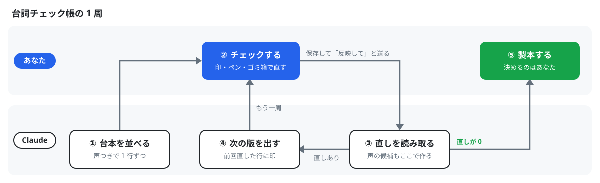
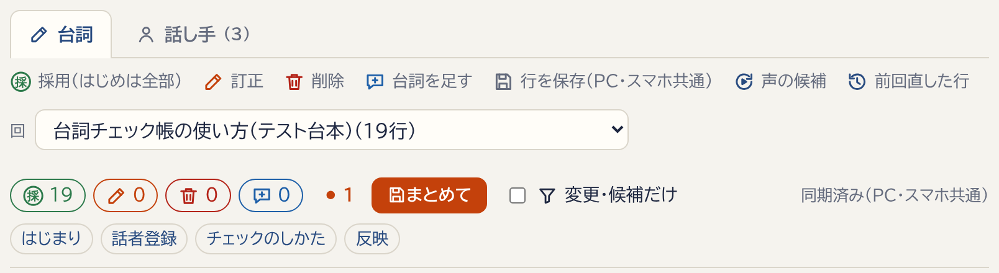
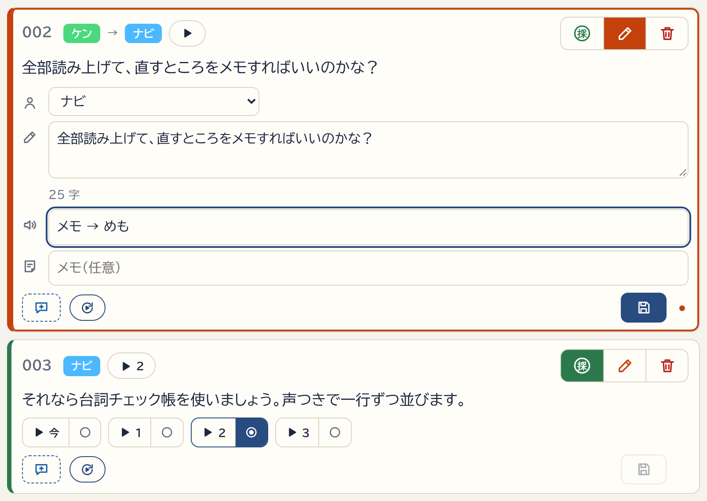
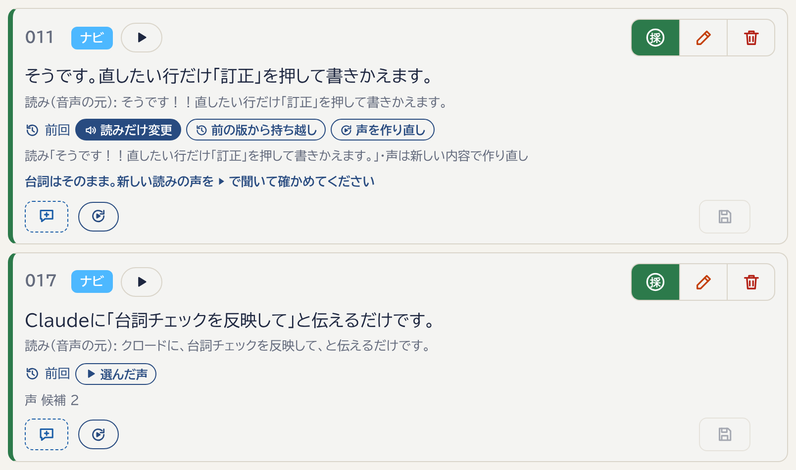
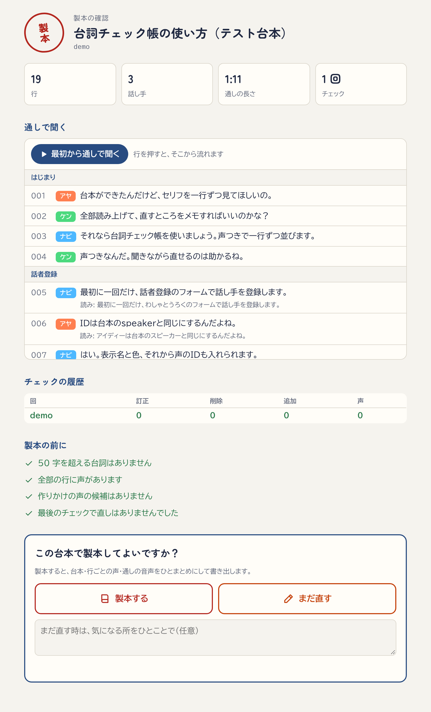

# daihon-mirune（台本見るね）— 台詞チェック帳

台本を 1 行ずつ声つきで並べ、印・ペン・ゴミ箱で直しを付けると、Claude が次の版を出す Claude Code のスキル。
直しが無くなるまで繰り返し、最後に「製本してよいか」を聞いて、台本と声をひとまとめに書き出す。



図解の使い方ガイド（1 ページ・画像入り）: [docs/usage/usage.html](docs/usage/usage.html)
（ダウンロードしてブラウザで開く。画像は中に埋め込み済み）

## 使い方

1. **話し手と声を登録する** — ページの「話し手」タブで、名前・色・声を登録する。登録はすぐ全員の画面に出る
2. **チェックする** — 行ごとに 採（採用）／ペン（訂正）／ゴミ箱（削除）／＋（台詞を足す）を付けて保存する
3. **チャットで「反映して」と送る** — Claude が直しを読み取り、声の候補を作り、次の版（v2・v3…）を出す
4. **次の版を見る** — 前回直した行に印が付き、その行だけが並ぶ。読み方だけ変えた行は「読みだけ変更」と出る
5. **製本する** — 直しが 0 になると、通しで聞ける確認ページが届く。「製本する」で台本・声・通しの音声を書き出す

| チェックする | 声の候補から選ぶ |
|---|---|
|  |  |
| **次の版（前回の印）** | **製本の確認** |
|  |  |

声の候補はボタンを押した直後には出ない。ページは外のサービスへ通信できず、API キーもページに置けないので、
**候補を作るのは Claude で、次の返事の中で作る**。訂正で話し手・台詞・読み方を変えて保存した行は、ボタンを押さなくても依頼が出る。

## 入れ方

このリポジトリの中身を、使うプロジェクトの `.claude/skills/daihon-mirune/` にそのまま置く（`SKILL.md` が直下に来る形）。

```bash
git clone https://github.com/takahashi919/daihon-mirune.git .claude/skills/daihon-mirune
```

要るもの: Python 3（標準ライブラリのみ）・ffmpeg・Claude Code（ページの公開に Artifact を使う）。

### 声（音声合成）

- 既定は Fish Audio の無料枠のモデル `s2.1-pro-free`。設定は `config.json` の `tts`
- **API キーは `config.json` に書かない。** `.env.example` を `.env` に写して `FISH_API_KEY=` を書くか、環境変数 `FISH_API_KEY` に入れる（`.env` は commit されない）
- 録った音声（wav）だけで使うなら `"provider": "none"`。別のサービスを足すなら `scripts/tts.py` に 1 クラス足す

### 見本で試す

`examples/demo/` に、3 人がこのスキルの使い方を話す見本の台本（19 行）がある。

```bash
python3 scripts/build_check_page.py --episode-dir examples/demo --id demo --config examples/demo/config.json --tts all --site output/daihon-mirune
```

```bash
python3 dev/serve.py output/daihon-mirune
```

声を作るには API キーが要る（上の「声」）。キー無しで画面だけ試すなら `--tts all` を `--no-audio` に替える。

ブラウザで `http://127.0.0.1:8766/index.html#demo` を開く（保存はその端末だけ。共有の保存は Claude がページを公開した時に有効になる）。

## ドキュメント

| 読む人 | ファイル | 中身 |
|---|---|---|
| 使う人 | [docs/usage/usage.html](docs/usage/usage.html) | 画面つきの使い方ガイド |
| Claude（agent） | [SKILL.md](SKILL.md) | 言われたこと → やることの早見表、毎ターンの固定手順、各工程のコマンド |
| コードを読む人 | [docs/ARCHITECTURE.md](docs/ARCHITECTURE.md) | データの流れ・ページの保存先の形・競合を防ぐ決まり・ページとスクリプトで揃えている規則 |

## 中身

| 場所 | 役目 |
|---|---|
| `assets/index.html` | 台詞チェック帳のページ |
| `assets/speakers.html` | ページを作る前に `config.json` を作る話者登録フォーム |
| `assets/bind.html` | 製本の確認ページ |
| `scripts/build_check_page.py` | 台本をページに載せる形に書き出す（声も作れる） |
| `scripts/collect_results.py` | ページに保存された直しを、反映用の JSON にまとめる |
| `scripts/make_voice_candidates.py` | 声の候補を 3 つずつ作る |
| `scripts/sync_speakers.py` | ページで登録した話し手を `config.json` に写す |
| `scripts/apply_review.py` | 直しを台本に入れて次の版を作る |
| `scripts/bind_script.py` | 製本の確認ページを作る（ask）・製本する（bind） |
| `scripts/tts.py` | 音声合成サービスの差し替え口（既定 Fish Audio） |
| `config.json` / `.env.example` | 話し手と音声合成の設定 / API キーの置き方の見本 |
| `examples/demo/` | 見本の台本 |
| `dev/` | 手元でページを試すための偽の保存先と、UTF-8 を返すサーバ |

## ライセンス

MIT（[LICENSE](LICENSE)）
