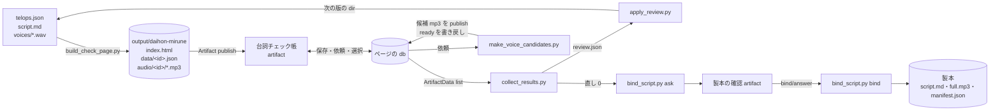

# daihon-mirune の仕組み

コードを読む人向けの地図。使い方は `README.md`、agent の手順は `SKILL.md`。

## 登場するもの

| もの | どこ | 役目 |
|---|---|---|
| 台詞チェック帳 | `assets/index.html` → artifact | オーナーが行ごとに採用・訂正・削除・追加・声の選択をするページ。話し手の登録もここ |
| 話者登録フォーム | `assets/speakers.html` | ページを作る前に `config.json` を作るための単体フォーム（外と通信しない） |
| 製本の確認 | `assets/bind.html` → 別の artifact | 直しが無くなった版を通しで聞いて「製本する／まだ直す」を答えるページ |
| スクリプト | `scripts/*.py` | Claude が回す。標準ライブラリと ffmpeg だけで動く |
| 設定 | `config.json` | 話し手（名前・色・声 ID）と音声生成サービス。キーは入れない |
| キー | `.env` / 環境変数 `FISH_API_KEY` | 音声生成サービスの API キー。`.gitignore` 済み |

## データの流れ

なぜこの形か:

- **ページは外へ通信できない**（artifact は許可された CDN 以外に fetch できない）。だから音声生成はページではなく Claude 側で動く。
  ページは「この行の声がほしい」という依頼を db に書くだけで、Claude が次のターンで作って書き戻す
- **キーをページに置かない**。ページを開ける人なら誰でもキーを読めてしまうため
- **状態は db に置く**（localStorage ではない）。PC とスマホで同じものを見せ、Claude からも読めるようにするため

## db の形（台詞チェック帳）

`n` は telops の通し番号（1 始まり）。版をまたぐと番号がずれるので、直した後は必ず別の回 id にする。

| パス | 書く人 | 中身 |
|---|---|---|
| `reviews/<id>/lines/<n:03d>` | ページ | `{n, st: ok｜fix｜del, sp, text, yomi, memo, adds[{sp,text,memo}], original, speaker, at}`。`speaker` は元の話し手、`sp` は訂正で選んだ話し手 |
| `reviews/<id>` | ページ | 全体コメント `{general, title, at}` |
| `reviews/<id>/voices/<n:03d>` | ページ（依頼・選択）と Claude（候補） | `{n, req, text, speaker, status: requested｜ready｜failed, candidates[{k,file}], for_req, pick, at}` |
| `speakers/<id>` | ページ（話し手タブ） | `{id, name, color, voice, at}`。削除は `deleted: true`（名前と色は残す） |

製本の確認ページは別の artifact で、db は `bind/answer` `{choice: bind｜revise, note, id, at}` だけ。

### 競合を防ぐ決まり

- **行の保存** はページが `at`（単調増加の時刻）を付けて `set`。届いた snapshot が自分の最後の保存より古ければ捨てる
  （遅れて届いた古い版で、書いたばかりの台詞が戻らないように）。未保存の行には snapshot を当てない
- **声の依頼** は `req`（依頼の時刻）で世代を見分ける。Claude は候補に `for_req = req` を付けて書き戻し、ページは
  `for_req !== req` の候補を出さない（作っている間に依頼し直されたら、古い候補は隠れる）
- Claude の書き戻しは ArtifactData の `if_version` 付き。list の後に依頼し直されていれば書かれず、その行は次のターンで作り直す
- **話し手の削除** は消さずに `deleted: true` を書く。すでにその人を使っている行が ID だけの表示にならないように
- 台詞を編集中に話し手の変更が届いたら、その行から離れた時に描き直す（入力中の下書きを壊さない）

## スクリプト

| スクリプト | 入力 | 出力 | 呼ぶ時 |
|---|---|---|---|
| `build_check_page.py` | 回の dir・`config.json` | `output/daihon-mirune/`（ページ・data・声） | 回を足す時（`--tts` で声を作る） |
| `collect_results.py` | db の lines・voices・全体コメント | 結果 JSON（`edits`） | 毎ターン |
| `make_voice_candidates.py` | db の voices・speakers・lines | 候補 mp3・`voice_updates.json` | 毎ターン（依頼があれば） |
| `sync_speakers.py` | db の speakers | `config.json` | 毎ターン |
| `apply_review.py` | 前の版の dir・結果 JSON | 次の版の dir・`review_changes.json` | 直しがあった時 |
| `bind_script.py ask` / `bind` | 最終版の data・履歴 | 確認ページ / 製本 | 直しが 0 になった時 |
| `tts.py` | `config.json` の `tts`・キー | 声の mp3 | 上から呼ばれる（音声生成サービスの差し替え口） |

ArtifactData の list に `out_dir` を付けると 1 文書 1 ファイルの JSON で落ちる。スクリプトはどれもそのフォルダか、
1 ファイルにまとめた JSON のどちらでも読む（`docs_in` などが入れ子をたどって、目当ての形の文書だけを拾う）。

## 判断の規則（ページとスクリプトで揃えているもの）

| 規則 | ページ | スクリプト |
|---|---|---|
| 何も変えていない訂正は採用 | `emptyFix()` | `collect_results.py` |
| 声が変わる訂正（話し手・台詞・読み）は自動で声の依頼 | `changesVoice()` → `autoVoice()` | `make_voice_candidates.py --lines` の `implied_requests()` |
| 読みの直し: 「A → B」は置き換え、それ以外は文そのもの | `applyYomi()` / `voiceRequest()` | `reading()`・`apply_yomi()` |
| 声が変わる訂正で候補を選ばなかった行は、次の版で作り直す | 「前回」の印 `voice_new` | `apply_review.py` |

片方だけ変えると、ページで見た依頼と Claude が作る声がずれる。変える時は両方を直す。

## ページの中（`assets/index.html` の script）

上から: 話し手の表（`rebuildSpeakers`）→ アイコン（`ICONS`）→ 状態（`draft` / `saved` / `voices`）→ 保存（`saveRow`）→
行の描画（`rowFor` / `renderAll`）→ 再生 → 声の候補（`requestVoice` / `paintVoice`）→ 集計（`summary`）→
db の受信（`applyDoc` / `applyVoice`）→ 回を開く（`openEpisode`）→ 話し手タブ → 起動。

- `draft[n]` は画面の値、`saved[n]` は保存済みと分かっている値。差があれば「未保存」
- `summary()` は保存済みの値だけで結果を組む（Claude が db から読むものと同じになるように）
- アイコンは 1 つの意味に 1 つの形（採用＝採の印、訂正＝ペン、削除＝ゴミ箱…）。どれも `aria-label` と `title` に名前を持つ

## 手元で試す

- `examples/demo/` の台本で `build_check_page.py --tts all` → `output/daihon-mirune/` を任意の HTTP サーバで開く
  （file:// では fetch が通らない。日本語のため `Content-Type` に `charset=utf-8` を付ける）
- 開くのは `python3 dev/serve.py output/daihon-mirune`（.html と .json に charset=utf-8 を付けて返す）
- db はページの外では `null` になり、ページは「この端末だけに保存」で動く。db ありの動きを試すなら `dev/mockdb.js` を先に読み込ませる。
